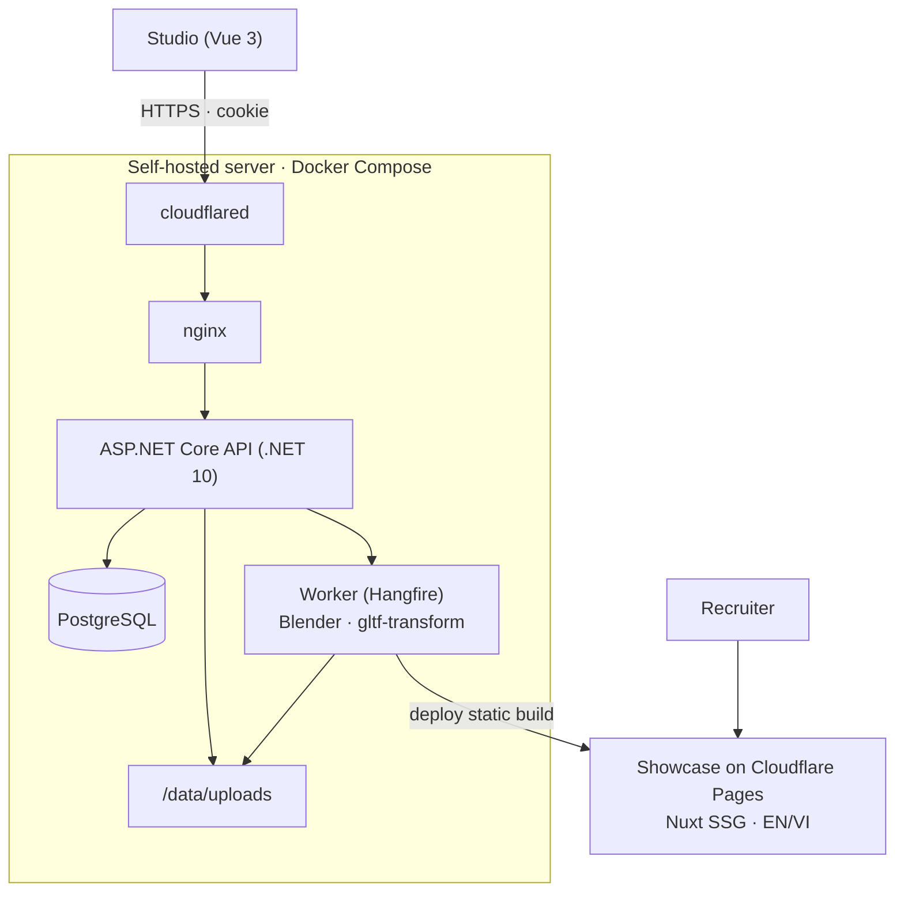

# show_case

3D model showcase and management — a personal portfolio where every model can be rotated 360° in the browser and inspected map by map (wireframe, base color, metallic, roughness, normal, AO).

The project has two web apps sharing one .NET backend:

- **Studio** — private admin (single owner) to upload `.glb` / `.fbx`, fill in EN/VI details and publish.
- **Showcase** — public, statically built site for recruiters, deployed to Cloudflare Pages so it stays up even when the server is off.

> Status: **GĐ0 — setup & spikes** (see [docs/plan.md](docs/plan.md)). Full spec: [docs/spec.md](docs/spec.md).

## Architecture



## Tech stack

| Area | Choice |
| --- | --- |
| Backend | ASP.NET Core (.NET 10), EF Core + Npgsql, FluentValidation, Serilog |
| Upload | tus (tusdotnet + Uppy), chunked, up to 100 MB |
| 3D pipeline | Blender headless (.fbx → .glb), `gltf-transform` (Meshopt, KTX2/WebP), SharpGLTF (stats) |
| Jobs | Hangfire on PostgreSQL, separate worker container |
| Studio | Vue 3 + Vite + TypeScript, PrimeVue, Pinia, TanStack Query |
| Showcase | Nuxt (static generate), @nuxtjs/i18n, Tailwind |
| Viewer | Three.js in a framework-free TypeScript package `viewer-core` |
| Infra | Docker Compose, Cloudflare Tunnel, Cloudflare Pages, GitHub Actions |

## Repository layout

```
backend/     .NET solution: Api, Application, Domain, Infrastructure, Worker   (GĐ1)
frontend/    pnpm workspace: studio, showcase, viewer-core, api-client         (GĐ3–GĐ5)
deploy/      docker-compose, nginx, cloudflared config, .env.example           (GĐ1, GĐ6)
spikes/      throwaway experiments for GĐ0 (FBX convert, viewer map modes)
docs/        spec and plan
```

## GĐ0 spikes

- [`spikes/convert`](spikes/convert) — convert `.fbx` to `.glb` with Blender headless, then optimize with `gltf-transform`.
- [`spikes/viewer`](spikes/viewer) — single HTML page: drop a `.glb`, orbit 360°, switch the 7 map modes with keys 1–7.
