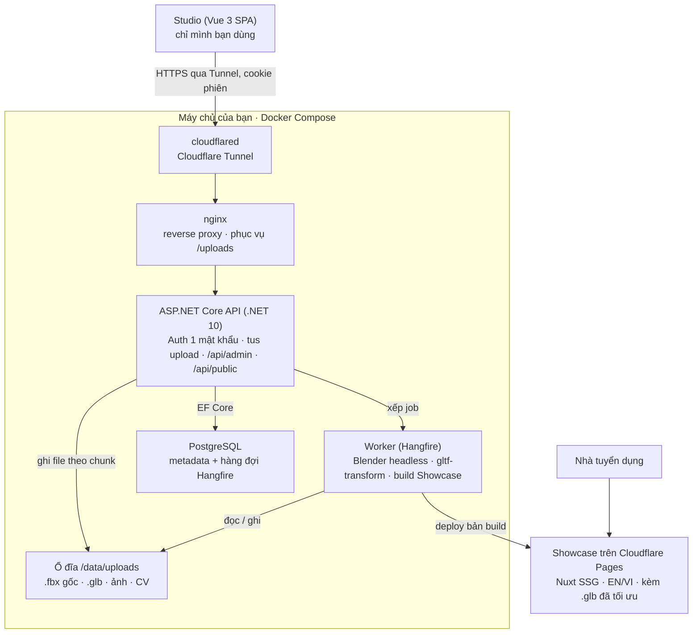

# Spec: 3D Model Portfolio (Admin + Showcase)

Cập nhật: 06/11/2026 · Nguyễn Đẩu Dương

## 1. Tổng quan & mục tiêu

Hệ thống gồm 2 web dùng chung 1 backend: **Studio** (trang quản trị riêng, chỉ mình bạn đăng nhập) để upload và quản lý model 3D, và **Showcase** (trang công khai) để nhà tuyển dụng xem, xoay, phóng to model ngay trên trình duyệt.

Dự án có hai giá trị với nhà tuyển dụng: (1) chứng minh kỹ năng dựng 3D qua các model, và (2) bản thân hệ thống là một sản phẩm fullstack .NET + SPA hoàn chỉnh — nên code, kiến trúc và deploy cũng là một phần của portfolio.

**Đối tượng người dùng**

| Vai trò | Dùng trang nào | Cần gì |
| --- | --- | --- |
| Chủ sở hữu (bạn) | Studio | Upload nhanh, sửa thông tin, ẩn/hiện, sắp xếp model |
| Nhà tuyển dụng / HR | Showcase | Mở link là xem được ngay, tải nhanh, không cần cài gì, xem được trên điện thoại |
| Tech lead phỏng vấn | Showcase + GitHub | Xem thông số kỹ thuật model (poly count, texture), xem source code dự án |

**Tiêu chí thành công**

- Nhà tuyển dụng mở link → thấy model đầu tiên xoay được trong dưới 3 giây (mạng 4G).
- Upload 1 model mới từ Studio đến lúc hiện trên Showcase mất dưới 2 phút thao tác.
- Showcase hiển thị tốt trên mobile, chia sẻ link lên LinkedIn/Zalo có ảnh preview.
- Chi phí vận hành gần 0 đồng/tháng (máy chủ có sẵn + gói miễn phí của Cloudflare).

## 2. Phạm vi

MVP tập trung vào vòng "upload → xử lý → publish → xem"; các tính năng đẹp mắt để giai đoạn sau.

| Hạng mục | MVP (bắt buộc) | Mở rộng (nếu còn thời gian) |
| --- | --- | --- |
| Studio | Bảo vệ bằng 1 mật khẩu, CRUD model, upload file + thumbnail, ẩn/hiện, gắn tag/danh mục, sắp xếp thứ tự | Upload nhiều version, nén Draco tự động, chụp thumbnail từ viewer, thống kê lượt xem |
| Showcase | Gallery lưới, lọc theo tag, trang chi tiết có viewer 3D xoay 360° + chuyển texture map, trang About/liên hệ, song ngữ EN/VI, responsive | So sánh trước–sau, xem AR trên mobile, thêm tiếng Nhật |
| Backend | REST API, lưu metadata vào DB, file trên ổ đĩa máy chủ, validate file, job nền convert .fbx + tối ưu + build Showcase | Log lượt xem, nhiều version file |
| DevOps | Deploy 1 môi trường, HTTPS, tên miền | CI/CD GitHub Actions, Docker, unit test + e2e test |

**Ngoài phạm vi:** nhiều người dùng, tài khoản, phân quyền, 2FA, bình luận/like, bán hoặc tải model về, chỉnh sửa model trên web.

## 3. Chức năng Studio (trang quản trị)

**3.1 Đăng nhập**

- Không có tài khoản, không đăng ký, không phân quyền: chỉ 1 mật khẩu admin, lưu dạng hash trong biến môi trường.
- Nhập đúng mật khẩu → API set cookie phiên HttpOnly + Secure, hạn 30 ngày; mọi route `/api/admin/*` chỉ kiểm tra cookie này.
- Vẫn cần lớp bảo vệ tối thiểu này vì API chạy công khai trên Internet: không có nó, ai biết URL cũng gọi được upload/xóa. Thêm rate limit cho endpoint login là đủ.
- Phương án không cần code login: đặt Studio và `/api/admin/*` sau Cloudflare Access (xác thực bằng mã OTP gửi về email của bạn).

**3.2 Dashboard**

- Tổng số model, số đang Published / Draft, dung lượng storage đã dùng.
- Danh sách model gần đây, nút "Upload model mới".

**3.3 Upload & quản lý model**

1. Kéo thả file model. Định dạng chính: **.glb** (khuyến nghị, 1 file gói cả texture). MVP nhận cả .glb và .fbx. File .fbx được giữ làm bản gốc, backend tự convert sang .glb bằng FBX2glTF để hiển thị trên web (trình duyệt không xem .fbx hiệu quả). Khi xuất .fbx cần bật nhúng texture (Path Mode = Copy + Embed Textures trong Blender), nếu không model lên web sẽ mất texture; sau khi convert, xem trước ở bước 3 để kiểm tra tỉ lệ, trục xoay và vật liệu.
2. Validate: đúng định dạng, giới hạn dung lượng (đề xuất ≤ 100 MB/file, đủ cho model nặng nhất khoảng 300.000 tam giác), đọc được bằng parser.
3. Xem trước ngay trong Studio bằng cùng viewer với Showcase.
4. Nhập thông tin: tiêu đề, slug, mô tả (Markdown), danh mục, tag, phần mềm dùng (Blender, Maya, ZBrush, Substance…), thời gian làm, ngày hoàn thành.
5. Thumbnail: upload ảnh, hoặc bấm "Chụp từ viewer" (canvas → PNG) ở giai đoạn mở rộng.
6. Thêm ảnh phụ (render, wireframe, quá trình làm) cho gallery trang chi tiết.
7. Cài đặt viewer cho từng model: góc camera mặc định, tự xoay, màu nền, ánh sáng (HDRI preset), bật/tắt animation nếu file có, chế độ xem mặc định (Final, Wireframe…).
8. Lưu Draft hoặc Publish.

**3.4 Thông số tự động trích xuất** — backend đọc file glTF để lấy số tam giác, số véc-tơ, số mesh, số material, số texture + độ phân giải, map nào có trong file (base color, metallic/roughness, normal, AO), có animation hay không, kích thước bounding box. Đây là điểm cộng với người xem chuyên môn.

**3.5 Danh sách & thao tác**

- Bảng model: lọc theo trạng thái; không cần phân trang hay tìm kiếm vì 6 tháng đầu chỉ khoảng 10 model.
- Đổi trạng thái Draft → Published → Archived; đánh dấu **Featured** (hiện ở đầu Showcase).
- Kéo thả để sắp thứ tự hiển thị.
- Thay file model (giữ nguyên link công khai), xóa mềm (soft delete).

**3.6 Quản lý danh mục, tag và hồ sơ** — CRUD danh mục (Nhân vật, Kiến trúc, Đồ vật, Xe cộ…) và tag; sửa nội dung trang About (giới thiệu, link CV, GitHub, LinkedIn, email).

## 4. Chức năng Showcase (trang công khai)

**4.1 Trang chủ / Gallery**

- Hero: tên, chức danh, 1 câu giới thiệu, 1 model Featured xoay tự động làm nền.
- Lưới card: thumbnail, tiêu đề, danh mục, phần mềm. Hover → hiện số tam giác.
- Lọc theo danh mục/tag ngay trên trình duyệt (chỉ khoảng 10 model nên tải hết 1 lần); tìm kiếm và phân trang để sau khi trên 30 model.
- Lazy load: chỉ tải ảnh thumbnail, không tải model 3D ở gallery.

**4.2 Trang chi tiết model** (`/models/{slug}`)

- Viewer 3D: xoay, zoom, pan, reset camera, fullscreen, bật/tắt tự xoay, chạy animation.
- Thanh tiến trình tải model + hiện thumbnail làm placeholder trong lúc tải.
- Xoay 360° và chuyển giữa các texture map (wireframe, base color, metallic, roughness, normal, AO): xem mục 4.3.
- Panel thông tin: mô tả, phần mềm, ngày làm, thông số kỹ thuật (mục 3.4), tag.
- Gallery ảnh phụ (render, wireframe, quá trình).
- Nút "Model trước / sau" và gợi ý model liên quan.
- Mobile: cử chỉ chạm, giảm pixel ratio để mượt; AR qua `<model-viewer>` (mở rộng).

**4.3 Viewer 3D: xoay 360° và xem từng texture map**

Viewer viết bằng Three.js (không dùng `<model-viewer>`), vì muốn tách từng kênh texture thì phải tự thay material/shader. Cùng 1 component dùng cho cả Studio và Showcase.

Xoay 360°:

- Kéo chuột / vuốt để xoay quanh model (OrbitControls): góc ngang không giới hạn, góc dọc giới hạn để không lật ngược (chỉnh được trong Studio).
- Nút Turntable: tự xoay 360° liên tục, chỉnh được tốc độ; tự dừng khi người xem chạm vào model.
- Nút đặt lại góc nhìn mặc định và fullscreen.

Chế độ xem texture map:

| Chế độ | Người xem thấy | Cách làm trong Three.js |
| --- | --- | --- |
| Final (PBR) | Model đầy đủ ánh sáng + môi trường HDRI | Material gốc từ file (MeshStandardMaterial) |
| Wireframe | Lưới tam giác (topology) trên nền xám, kèm số tam giác | Lớp wireframe phủ lên material xám (clay) |
| Base color | Màu gốc, không ánh sáng | MeshBasicMaterial, map = baseColor |
| Metallic | Ảnh xám, trắng = kim loại | Shader lấy kênh B của metallicRoughnessTexture |
| Roughness | Ảnh xám, trắng = nhám | Shader lấy kênh G của metallicRoughnessTexture |
| Normal | Normal map (màu tím–xanh) | MeshBasicMaterial, map = normalMap |
| Ambient occlusion | Vùng khuất tối | Shader lấy kênh R của occlusionTexture |

- Model không có map nào → nút đó bị mờ, tooltip "Model không có map này"; nếu file chỉ có hệ số (ví dụ metallic = 0) thì tô màu xám đồng nhất tương ứng.
- Đổi chế độ không tải lại file: giữ material gốc trong bộ nhớ, chỉ hoán đổi; texture đã tải được dùng lại.
- Desktop: thanh nút cho từng chế độ + phím tắt 1–7; mobile: gộp thành dropdown.
- Lưu ý .fbx: file .fbx từ Blender thường mất hoặc sai map metallic/roughness/AO khi convert. Muốn các chế độ này chính xác thì nên upload .glb; sau upload, Studio hiện danh sách map phát hiện được để bạn kiểm tra.
- Khi tối ưu texture, giữ nguyên cách đóng gói kênh; nén normal map ở chất lượng cao để không bị vệt khối.
- Mở rộng: thanh trượt so sánh 2 chế độ cạnh nhau, chế độ Clay/Matcap, xem UV layout.

**4.4 Trang About** — chỉ xoay quanh 3D: ảnh, giới thiệu ngắn, phần mềm và kỹ năng 3D, quy trình làm việc, nút tải CV (PDF), LinkedIn, email. Không gộp portfolio lập trình (dự án .NET, kinh nghiệm); tuỳ chọn đặt 1 dòng nhỏ ở footer "Built with .NET + Vue · source" trỏ về repo.

**4.5 SEO & chia sẻ**

- Mỗi model có URL riêng, thẻ `title`, `description`, Open Graph image = thumbnail → gửi link qua LinkedIn/Zalo có ảnh preview.
- Build tĩnh toàn bộ trang bằng `nuxt generate` (SSG), nên bot và mạng xã hội đọc được meta tag ngay.
- `sitemap.xml`, `robots.txt`.
- Nút copy link, link nhúng (iframe embed) cho từng model (mở rộng).

**4.6 Song ngữ EN/VI**

- URL theo ngôn ngữ: `/en/models/{slug}` và `/vi/models/{slug}`; thẻ `hreflang` cho SEO; nút chuyển ngôn ngữ ở header.
- Lần đầu vào: chọn theo ngôn ngữ trình duyệt, mặc định tiếng Anh; lựa chọn được nhớ bằng cookie.
- Chữ cố định của giao diện (nút, nhãn, tên 7 chế độ map) nằm trong file `en.json` / `vi.json` (@nuxtjs/i18n).
- Nội dung bạn nhập (tiêu đề, mô tả model, tên danh mục/tag, trang About) có 2 bản; Studio hiện 2 tab EN / VI trong form. Thiếu bản VI thì hiện bản EN.
- Studio chỉ cần giao diện tiếng Việt.

## 5. Mô hình dữ liệu

File model và ảnh nằm trên ổ đĩa máy chủ (`/data/uploads`); database chỉ lưu metadata và đường dẫn tương đối (storage key).

| Bảng | Cột chính | Ghi chú |
| --- | --- | --- |
| `Models` | Id, Slug (unique), CategoryId, Status (Draft/Published/Archived), IsFeatured, SortOrder, Software, HoursSpent?, CompletedAt?, ViewerSettings (jsonb), ViewCount, CreatedAt, UpdatedAt, DeletedAt? | Bảng trung tâm |
| `ModelTranslations` | ModelId, Locale (en/vi), Title, Description | Khóa chính (ModelId, Locale) |
| `ModelFiles` | Id, ModelId, Kind (Original/Optimized), Format (glb/fbx), StorageKey, SizeBytes, Version, IsCurrent, UploadedAt | Bản gốc .fbx + bản .glb dùng để hiển thị |
| `ModelStats` | ModelId, Triangles, Vertices, Meshes, Materials, Textures, MaxTextureSize, HasAnimation, AvailableMaps (jsonb), BoundingBox (jsonb) | Trích tự động khi upload |
| `ModelImages` | Id, ModelId, Kind (Thumbnail/Render/Wireframe/Process), StorageKey, CaptionEn, CaptionVi, SortOrder | Thumbnail + gallery ảnh |
| `Categories` | Id, NameEn, NameVi, Slug, SortOrder | |
| `Tags`, `ModelTags` | Id, NameEn, NameVi, Slug / ModelId, TagId | Quan hệ nhiều–nhiều |
| `SiteProfile` | DisplayName, HeadlineEn/Vi, BioEn/Vi, AvatarKey, CvKey, Links (jsonb) | Nội dung trang About |

Không có bảng `Users`: mật khẩu admin nằm trong cấu hình.

`ViewerSettings` ví dụ: `{ "autoRotate": true, "background": "#1a1a1a", "environment": "studio", "cameraOrbit": "45deg 75deg 2m", "exposure": 1.0 }`.

## 6. Kiến trúc & tech stack

Toàn bộ backend tự host trên máy chủ bằng Docker Compose (thông tin máy chủ bổ sung sau); file upload lưu trên ổ đĩa máy chủ. Riêng Showcase được build tĩnh và deploy lên Cloudflare Pages kèm sẵn file .glb đã tối ưu, nên máy chủ có tắt thì trang công khai vẫn chạy.



Luồng chính: Studio upload file theo chunk (giao thức tus) → API ghi vào `/data/uploads` và xếp job → worker convert .fbx sang .glb bằng Blender, tối ưu bằng `gltf-transform`, đọc thông số bằng SharpGLTF → khi bấm Publish, worker chạy `nuxt generate`, chép .glb đã tối ưu + thumbnail vào bản build và deploy lên Cloudflare Pages. Người xem chỉ tải từ Cloudflare, không chạm tới máy chủ.

**Tech stack**

| Phần | Chọn | Lý do |
| --- | --- | --- |
| Backend API | ASP.NET Core (.NET 10 LTS), EF Core + Npgsql, FluentValidation, Serilog; cấu trúc Api / Application / Domain / Infrastructure | Sở trường; bản LTS dùng lâu dài; thể hiện kỹ năng thiết kế của Senior |
| Đăng nhập | Cookie authentication của ASP.NET Core + `PasswordHasher`, rate limiting có sẵn của ASP.NET Core | 1 mật khẩu, không cần Identity đầy đủ |
| Upload file lớn | tusdotnet (API) + Uppy hoặc tus-js-client (Studio) | Chia chunk, rớt mạng thì upload tiếp, file 100 MB không bị timeout |
| Đọc thông số glTF | SharpGLTF | Thư viện .NET thuần |
| Convert .fbx → .glb | Blender chạy headless trong container worker; FBX2glTF làm dự phòng | File .fbx xuất từ Blender nên Blender đọc lại giữ vật liệu tốt nhất; FBX2glTF đã ngừng được bảo trì |
| Tối ưu .glb | `gltf-transform` (Node CLI) | Nén Meshopt/Draco, texture KTX2/WebP, tạo bản nhẹ cho điện thoại |
| Ảnh thumbnail | ImageSharp hoặc SkiaSharp | Resize, xuất WebP (card ~400 px, OG 1200×630) |
| Job nền | Hangfire, lưu job trong PostgreSQL, chạy ở container worker riêng | Convert, tối ưu, build Showcase không làm treo request; có dashboard theo dõi |
| Database | PostgreSQL chạy trong Docker trên máy chủ, cột jsonb | Đã có máy chủ nên không cần dịch vụ ngoài; sao lưu bằng `pg_dump` hằng đêm |
| Lưu file | Ổ đĩa máy chủ `/data/uploads` (Docker volume), qua interface `IFileStorage` | Sau này chuyển sang S3/AWS chỉ cần thêm 1 class |
| Studio | Vue 3 + Vite + TypeScript, Pinia, Vue Router, PrimeVue, TanStack Query (vue-query), VeeValidate + Zod | PrimeVue có sẵn bảng, kéo thả, upload; vue-query lo cache và gọi lại API |
| Showcase | Nuxt build tĩnh (`nuxt generate`), @nuxtjs/i18n (EN/VI), Tailwind; deploy Cloudflare Pages | SEO, ảnh preview khi chia sẻ link, không cần server lúc chạy |
| Viewer 3D | Three.js thuần trong package TypeScript `viewer-core` (GLTFLoader, MeshoptDecoder, KTX2Loader, OrbitControls, shader tách kênh), bọc bằng 1 component Vue mỏng | Tự thay shader để xem từng map (mục 4.3); dùng chung cho Studio và Showcase |
| API client | Sinh tự động từ OpenAPI (orval hoặc openapi-typescript) | Kiểu dữ liệu ở frontend luôn khớp backend |
| Hạ tầng | Docker Compose: nginx, api, worker, postgres, cloudflared | Chạy giống nhau trên máy dev và máy chủ |
| Đưa ra Internet | Cloudflare Tunnel (miễn phí); tuỳ chọn Cloudflare Access cho Studio | Không cần IP tĩnh hay mở port router, có HTTPS sẵn |
| Kiểm thử | xUnit + Testcontainers (PostgreSQL thật), Vitest + Vue Test Utils, Playwright (e2e) | Test chạy trên database thật |
| CI/CD | GitHub Actions: test → build image → đẩy lên GHCR → deploy lên máy chủ | Chi tiết deploy chốt khi có thông tin máy chủ |

**Ba quyết định quan trọng**

1. **Showcase không phụ thuộc máy chủ.** Bản build tĩnh chứa sẵn .glb đã tối ưu (≤ 10 MB mỗi file) và thumbnail, deploy lên Cloudflare Pages. Cần kiểm tra lại giới hạn dung lượng mỗi file của Pages (khoảng 25 MB). File gốc .fbx chỉ nằm trên máy chủ.
2. **Tách worker khỏi API.** Image có Blender rất nặng nên để ở container worker; container API nhẹ, khởi động nhanh.
3. **Viewer là package độc lập.** `viewer-core` không phụ thuộc Vue — phần đáng khoe nhất khi phỏng vấn (shader tách kênh, Meshopt/KTX2, tự giảm chất lượng trên điện thoại).

**Vì sao chọn Vue 3 cho cả 2 trang**

| Phương án | Điểm cộng | Điểm trừ |
| --- | --- | --- |
| **Vue cho cả 2 (chọn)** | Sở trường → nhanh ra MVP, code sạch; dùng chung viewer, kiểu dữ liệu, API client, file i18n giữa Studio và Showcase; Nuxt lo SEO/i18n cho Showcase | Không thêm framework mới vào CV |
| Studio bằng Angular | Thêm framework, hợp kiểu form CRUD doanh nghiệp | Phải viết lại wrapper viewer, API client; 1 người duy trì 2 hệ sinh thái; tốn thêm vài tuần |
| Studio bằng React | Thị trường tuyển nhiều nhất | Như trên; Studio chỉ mình bạn thấy nên nhà tuyển dụng gần như không xem tới |

Vì viewer nằm trong package TypeScript độc lập, sau này có thể viết lại Studio bằng React/Angular mà không đụng tới viewer.

**Vì sao chọn PostgreSQL**

Ban đầu spec chọn Neon (PostgreSQL miễn phí trên cloud). Khi đã chốt tự host trên máy chủ, PostgreSQL chạy luôn trong Docker Compose là đơn giản nhất: không phụ thuộc dịch vụ ngoài, dùng chung cho Hangfire, sao lưu cùng thư mục upload. Nếu sau này chuyển lên cloud, có thể dùng Neon hoặc Amazon RDS mà không đổi code (EF Core + Npgsql). Không chọn Azure SQL free (hết quota thì database dừng tới đầu tháng sau) và Supabase free (tạm dừng project khi một tuần ít hoạt động).

**Nên tránh:** `<model-viewer>` (không cho đổi shader), chạy Nuxt SSR trên máy chủ (thêm một điểm có thể sập), lưu file 3D trong database, AWS App Runner (đã ngừng nhận khách hàng mới).

**Cấu trúc repo**

```
backend/     Api, Application, Domain, Infrastructure, Worker (.sln)
frontend/    pnpm workspace: studio, showcase, viewer-core, api-client
deploy/      docker-compose.yml, nginx.conf, cloudflared config
.github/     workflows
```

## 7. API endpoints

Tách 2 nhóm route: `/api/public/*` (không cần token, có cache) và `/api/admin/*` (bắt buộc cookie phiên). File lớn (đến 100 MB) được upload theo từng chunk qua giao thức tus để không bị timeout và tiếp tục được khi rớt mạng. Showcase chỉ gọi `/api/public/*` lúc build, không gọi khi người xem truy cập.

| Method | Endpoint | Mô tả |
| --- | --- | --- |
| POST | `/api/auth/login` | Kiểm tra mật khẩu, set cookie phiên 30 ngày |
| POST | `/api/auth/me` | Kiểm tra còn đăng nhập không (Studio gọi khi mở) |
| POST | `/api/auth/logout` | Xóa cookie phiên |
| GET | `/api/public/models` | Danh sách model Published (trả hết, lọc phía client) |
| GET | `/api/public/models/{slug}` | Chi tiết + stats + ảnh + URL file |
| POST | `/api/public/models/{slug}/view` | Tăng lượt xem (rate limit theo IP) |
| GET | `/api/public/categories`, `/api/public/tags` | Dữ liệu bộ lọc |
| GET | `/api/public/profile` | Nội dung trang About |
| GET | `/api/admin/dashboard` | Số liệu tổng quan |
| GET / POST | `/api/admin/models` | Danh sách tất cả / tạo model (Draft) |
| GET / PUT / DELETE | `/api/admin/models/{id}` | Xem / sửa / xóa mềm |
| POST / PATCH | `/api/admin/uploads` (tus) | Upload file model theo chunk, ghi vào ổ đĩa máy chủ |
| POST | `/api/admin/models/{id}/files/{fileId}/complete` | Báo upload xong → xếp job: validate, convert .fbx, tối ưu, trích stats |
| GET | `/api/admin/jobs/{jobId}` | Trạng thái job (Studio hỏi định kỳ để hiện tiến trình) |
| POST | `/api/admin/showcase/build` | Build lại Showcase thủ công (tự chạy sau mỗi lần Publish) |
| POST | `/api/admin/models/{id}/images` | Upload thumbnail / ảnh phụ |
| PATCH | `/api/admin/models/{id}/status` | Draft / Published / Archived, Featured |
| PUT | `/api/admin/models/order` | Lưu thứ tự sau khi kéo thả |
| CRUD | `/api/admin/categories`, `/api/admin/tags` | Quản lý danh mục, tag |
| PUT | `/api/admin/profile` | Sửa trang About, upload CV |

Tài liệu API bằng OpenAPI/Swagger (chỉ bật ở môi trường dev hoặc có bảo vệ).

## 8. Yêu cầu phi chức năng

**Hiệu năng**

- Model 300.000 tam giác chưa nén có thể nặng vài chục MB, quá nặng để mở trên 4G. Worker tự chạy `gltf-transform optimize` sau khi upload/convert (nén Meshopt/Draco + texture KTX2/WebP), mục tiêu file hiển thị ≤ 10 MB.
- Với model trên 150.000 tam giác, cân nhắc thêm bản giản lược (~100.000 tam giác, `gltf-transform simplify`) để Showcase dùng trên điện thoại.
- File model và ảnh của Showcase phục vụ từ CDN của Cloudflare Pages, header `Cache-Control` dài hạn (tên file có hash).
- Thumbnail tạo 2 kích thước (card ~400 px, OG 1200×630), định dạng WebP.
- Lighthouse Performance Showcase ≥ 85 trên mobile.

**Bảo mật**

- Mật khẩu hash bằng ASP.NET Identity PasswordHasher hoặc BCrypt; rate limit endpoint login.
- CORS chỉ cho phép domain Studio và Showcase.
- Validate file bằng nội dung (magic bytes / parse glTF, header FBX), không tin phần mở rộng; giới hạn dung lượng.
- Thư mục upload nằm ngoài thư mục code, tên file là GUID, nginx chỉ phục vụ qua đường dẫn cho Studio; file công khai chỉ là bản đã chép vào build Showcase. Sao lưu thư mục này cùng database hằng đêm.
- Máy chủ không mở port ra Internet: mọi truy cập đi qua Cloudflare Tunnel.
- Secrets (connection string, storage key, hash mật khẩu admin) để trong biến môi trường, không commit lên GitHub.
- Studio không được index: `noindex` + không liên kết từ Showcase.

**Vận hành & chất lượng code**

- Logging bằng Serilog, health check `/health`.
- Unit test cho service (xUnit), test API bằng WebApplicationFactory; e2e Showcase bằng Playwright (mở rộng).
- README có sơ đồ kiến trúc, ảnh chụp, hướng dẫn chạy local bằng `docker compose up` — nhà tuyển dụng hay đọc README trước code.

**Chi phí** — Cloudflare Pages, Cloudflare Tunnel và GitHub Actions đều dùng gói miễn phí; chi phí cố định là tên miền (vài trăm nghìn đồng/năm) và tiền điện của máy chủ nếu máy chỉ bật cho dự án này. Khoảng 10 model trong 6 tháng chỉ cần cỡ vài trăm MB ổ đĩa. Cần kiểm tra giới hạn gói miễn phí hiện tại của Cloudflare Pages trước khi triển khai.

## 9. Lộ trình triển khai

Làm theo thứ tự backend → Studio → Showcase để có dữ liệu thật khi dựng trang công khai; số tuần là ước tính cho khoảng 10–12 giờ/tuần.

| Giai đoạn | Thời gian (ước tính) | Công việc |
| --- | --- | --- |
| GĐ1 · Nền tảng | Tuần 1–2 | Repo, Docker, CI · Schema DB + migration · Đăng nhập 1 mật khẩu · Upload tus + lưu file local · Hangfire worker |
| GĐ2 · Studio | Tuần 3–4 | Upload + convert .fbx · Trích thông số model · CRUD, tag, danh mục · Viewer dùng chung |
| GĐ3 · Showcase | Tuần 5–6 | Gallery + bộ lọc · Viewer 360° + 7 chế độ map · EN/VI, About, SEO, OG · Responsive mobile |
| GĐ4 · Ra mắt MVP | Tuần 7 | Deploy + tên miền · Đăng các model đầu tiên · README + ảnh chụp · Gắn link vào CV |
| GĐ5 · Mở rộng | Sau MVP, làm dần | Nén Draco tự động · wireframe/clay · AR · tiếng Nhật · thống kê lượt xem · e2e test |

Có thể chuẩn bị song song 3–5 model .glb đã tối ưu từ GĐ1 để test upload và có nội dung khi ra mắt.

## 10. Câu hỏi mở cần chốt

- [x] Định dạng xuất model — **Chốt:** MVP nhận cả .glb và .fbx; .fbx được convert tự động sang .glb khi upload (mục 3.3).
- [x] Model nặng nhất — **Chốt:** khoảng 300.000 tam giác → giới hạn upload 100 MB, bắt buộc tối ưu trước khi đăng (mục 8).
- [x] Số model 6 tháng đầu — **Chốt:** khoảng 10 → bỏ phân trang/tìm kiếm. (Worker vẫn cần ngay từ MVP để convert .fbx bằng Blender và build Showcase.)
- [x] Frontend — **Chốt:** Vue 3 cho cả 2 trang (Studio: Vue SPA, Showcase: Nuxt); viewer là package TypeScript độc lập (mục 6).
- [x] Database — **Chốt:** PostgreSQL chạy trong Docker trên máy chủ (mục 6).
- [x] Lưu file — **Chốt:** trên ổ đĩa máy chủ; Showcase build tĩnh lên Cloudflare Pages (mục 6).
- [ ] Thông tin máy chủ (hệ điều hành, RAM, ổ đĩa, đường mạng) — bạn sẽ gửi sau; cần để chốt phần deploy.
- [x] Ngôn ngữ Showcase — **Chốt:** tiếng Anh + tiếng Việt (mục 4.6).
- [x] Portfolio lập trình — **Chốt:** không gộp, Showcase chỉ dành cho 3D (mục 4.4).
- [ ] Tên miền và repo GitHub — bạn sẽ gửi repo sau; cần 1 tên miền chung cho Studio, Showcase và API để cookie hoạt động.
